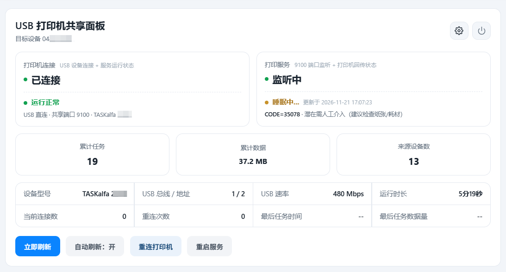

<p align="center">
  
</p>

# 🖨️ p910nd-panel



把一台 USB 打印机变成网络打印机的**单容器服务**：内置 **9100 RAW / JetDirect** 打印服务，同时提供 **8910** Web 管理面板。整个程序只有一个 `panel.py`，没有数据库、没有前端构建、没有多余进程。

适用于内核裁剪、没有 `usblp` / `usbprinter` 模块、也没有 `/dev/usb/lp*` 节点的系统（例如飞牛 fnOS）。这类环境里 p910nd 根本跑不起来，本项目改用 **pyusb 直接操作 USB 打印接口（class 7 Bulk OUT）**，绕开内核打印驱动，同时用 USB 状态通道（Bulk IN + `@PJL INFO STATUS`）把打印机自己报的故障读回来。

## ✨ 功能

**打印服务**

- 📡 **9100 RAW 打印**：标准 JetDirect 端口，客户端按 TCP/IP + RAW 添加即可
- 🔒 **单任务串行化**：同一时刻只允许一个客户端占用 USB，后到的任务排队等待，避免两股数据流交错写坏
- 🔁 **断线自愈**：USB 拔出/重插、设备更换都会自动重连；连续失败 4 次自动重启进程重建 libusb 上下文（10 分钟限流一次）
- 🧾 **空任务识别**：客户端连上却没发数据，记为「空任务」并忽略，不污染统计

**Web 面板（8910）**

- 🖥️ **首页**：打印机连接卡（USB 连接状态 + 服务状态三态）、打印服务卡（9100 监听 + 打印机回传状态）、累计任务 / 累计数据 / 来源设备数三张小卡、设备详情、四个操作按钮（立即刷新 · 自动刷新 · 重连打印机 · 重启服务）
- 🩺 **打印机状态回传**：把打印机自己报的 `CODE=` 与 `DISPLAY=` 原文显示在面板，代码后面附中文解释（卡纸 / 缺纸 / 盖板未关 / 碳粉不足等），多编码自动识别（京瓷一类中文面板也不会乱码）
- 📊 **打印统计**：按天统计成功 / 失败 / 字节数，保留 180 天；可选近 7 / 14 / 30 天，**PC 默认 14 天、手机默认 7 天**，手动切换会记住；图表固定画满所选天数，有数据的那几天居中、前后用带日期的空位补齐；点有柱子的日期看当天明细（总次数、成功/失败、数据量、来源分布）
- 📝 **打印监控**：时间、来源 IP、来源主机（反查主机名或备注）、数据量、耗时、结果；**默认每页 5 条**，可选 5 / 10 / 20 / 30 / 50 / 100 并记住选择；总保留条数 100 ~ 5000（默认 1000）可在网页改
- 🏷️ **来源管理（紧凑列表）**：给来源 IP 起名字（如「三楼打印室」，最多 30 字），备注为空时默认显示反查到的主机名，同时显示每个来源**最近一次发任务的时间与文件大小**、累计文件数与累计数据量；不需要的来源可用右上角「移除来源」移出列表（历史记录与统计仍保留）；**同一台设备换了 IP（路由器重新分配）只要反查到的主机名不变，就会自动归并到同一条来源，备注与历史数据一起继承**；主机名先问 NetBIOS（`nbtstat -A`，Windows 客户端一定有），再退 DNS 反查，启动时还会给历史上没有主机名的来源补查一次
- 📜 **运行日志**：面板里增量滚动显示，写入 `data/panel.log`，超过 1 MB 自动压回最近 3000 行，进程重启后自动载回
- 🧮 **累计任务 / 累计数据**：跨重启、跨镜像更新保留，可在「数据管理」页一键清零

**安全与配置**

- 🔐 **首次自设密码**：没有用户名，只有密码；PBKDF2-SHA256 加盐哈希，明文永不落盘
- 🚫 **暴力破解防护**：同一 IP 连续 5 次失败锁定 60 秒
- 🍪 **会话 12 小时**，改密后轮换 `secret_key`，其他设备上的登录立即失效
- ⚙️ **设置中心 `/settings`**：设备设置、来源管理、数据管理、推送配置、修改密码五个入口，分项页顶部五等分导航
- 🔌 **设备设置**：扫描容器内可见的 USB 设备并点选填入，保存后热重连，不用重启容器
- 🔔 **Pushplus 推送**：11 个渠道（`wechat` `app` `extension` `webhook` `clawbot` `cmcc` `qq` `cp` `mail` `sms` `voice`），覆盖**离线 / 恢复 / 打印失败**三类事件；失败推送 10 分钟内只发一次
- ❤️ **`/healthz` 免登录健康检查**：不读 USB、不需要登录，供 Docker HEALTHCHECK 使用

## 🚀 快速开始

### 方式一：直接拉镜像（推荐）

镜像由 GitHub Actions 自动构建，一条地址同时包含 `linux/amd64`、`linux/arm64`、`linux/arm/v7`、`linux/386` 四种架构，按设备架构自动匹配，不用挑标签。

新建 `docker-compose.yml`：

```yaml
services:
  p910nd-panel:
    image: ghcr.io/meyzh/p910nd-panel:latest
    container_name: p910nd-panel
    restart: unless-stopped
    stdin_open: true      # NAS 网页终端进容器需要
    tty: true
    privileged: true
    # 必须 host 网络（bridge 下看不到客户端真实 IP，来源管理无法按设备归并）
    # host 模式下 9100 / 8910 直接占用 NAS 端口，所以这里不写 ports
    network_mode: host
    devices:
      - /dev/bus/usb:/dev/bus/usb
    volumes:
      - ./data:/app/data
    environment:
      - TZ=Asia/Shanghai
      - PRINTER_ID=        # 留空则在 /device 页扫描填入
      - JOB_KEEP=1000      # 打印监控保留条数，也可在「数据管理」页改
```

```bash
mkdir -p data
docker compose pull
docker compose up -d
```

### 端口在哪看（host 网络）

`network_mode: host` 下 `docker ps` 的 PORTS 列是空的，这不是没映射，而是不需要映射：容器直接用 NAS 的网络栈。

- **面板**：`http://NAS的IP:8910`
- **打印**：客户端添加打印机时填 `NAS的IP`、端口 `9100`、协议 `RAW`

不知道 NAS IP 时，三个地方都能查到：`docker compose logs` 启动日志会打印「面板地址 / 打印端口」两行；面板「设置中心」首页有一条「访问地址」；也可以在 NAS 本机 `ip a` 或 `hostname -I` 看。

如果 8910 或 9100 已被飞牛上的其他服务占用，改 `environment` 里的 `WEB_PORT` / `PRINT_PORT`（如 `8911` / `9101`）即可，两个端口都支持。启动日志会明确写出哪个端口绑定失败、该改哪个变量，不会只丢一个 Traceback。换了打印端口后，客户端添加打印机时填新端口。

### 方式二：从源码构建

```bash
git clone https://github.com/meyzh/p910nd-panel.git
cd p910nd-panel
mkdir -p data
docker compose up -d --build
docker compose logs -f
```

🌐 浏览器打开 `http://<NAS-IP>:8910`，首次访问会跳到 `/setup` 让你设置访问密码（≥8 位、不能纯数字）。

🖨️ 客户端添加打印机：设备类型 **TCP/IP**，IP 填 NAS 地址，**端口 9100**，协议 **RAW / 标准**，驱动选你打印机的型号。

### 💡 只想改面板代码，不想重新 build

在 `docker-compose.yml` 里加一行挂载，把 `panel.py` 直接盖进容器：

```yaml
    volumes:
      - ./data:/app/data
      - ./panel.py:/app/panel.py:ro
```

之后改完 `panel.py` 只需要：

```bash
docker restart p910nd-panel
```

不需要 `docker compose build`。NAS 上的 `docker.fninas.com` 加速源对 `debian:bookworm-slim` 经常返回 `401 Unauthorized`，这条路能完全绕开它。

## 🖥️ 面板页面

| 页面 | 用途 |
| --- | --- |
| `/setup` | 首次启动设置密码（设好后永久失效） |
| `/login` | 日常登录（只有密码框） |
| `/` | 主页：状态卡、统计图、打印监控、运行日志、操作按钮 |
| `/settings` | 设置中心，五个入口汇总 |
| `/device` | 选择 / 扫描 USB 打印机设备 |
| `/notes` | 来源管理：备注、最近一次时间、累计文件数与数据量、删除来源 |
| `/data` | 保留条数、清零累计、清除记录与统计 |
| `/push` | Pushplus 令牌、渠道、触发条件、测试推送 |
| `/password` | 修改访问密码 |
| `/license` | 使用许可（免登录） |
| `/robots.txt` | 禁止收录（免登录） |
| `/healthz` | 健康检查 JSON `{"ok":true,"uptime":N}`（免登录） |

## 📁 文件说明

最小可用的四个文件 + 一个数据目录即可跑起来：

| 文件 | 说明 |
| --- | --- |
| `panel.py` | 主程序，打印服务 + Web 面板全部功能（单文件，约 155 KB） |
| `Dockerfile` | 镜像构建（Debian + Python + Flask + pyusb + libusb，构建期自检依赖） |
| `docker-compose.yml` | 容器定义（端口、USB 直通、`data` 持久化、可选 `panel.py` 挂载） |
| `部署文档.md` | 单机部署的完整步骤与排错 |
| `data/` | 持久化目录（配置、任务记录、统计、累计、日志），**不入库** |
| `.env.example` | 可选参数示例（镜像地址、端口、推送、时区） |
| `.github/workflows/build.yml` | 推送到 main 自动构建四架构镜像 → GHCR（仅完整仓库包含） |
| `LICENSE` | 使用许可：禁止商业用途，二次开发须保留版权 |

## 💾 数据与配置

`data/` 目录下这些文件：

| 文件 | 内容 |
| --- | --- |
| `config.json` | 设备 ID、密码哈希、`secret_key`、推送配置、来源备注与已删除来源、保留条数 |
| `jobs.json` | 打印任务记录（默认 1000 条，可在网页调整） |
| `stats.json` | 每日统计，保留 180 天 |
| `totals.json` | 累计任务数、累计字节数、起始时间 |
| `panel.log` | 运行日志（重启后自动载回，保留 3000 行） |

✅ 备份 = 备份整个 `data/` 目录；恢复 = 原样放回后重启容器。

环境变量（只作为首次启动的初始值，之后以 `data/config.json` 为准）：

| 变量 | 说明 | 默认 |
| --- | --- | --- |
| `PRINTER_ID` | 打印机 `vid:pid`，可留空后在 `/device` 页扫描填入 | 空 |
| `PUSHPLUS_TOKEN` / `PUSHPLUS_CHANNEL` | Pushplus 令牌 / 默认渠道 | 空 / `wechat` |
| `PUSHPLUS_OPTION` / `PUSHPLUS_TO` / `PUSHPLUS_TOPIC` | 渠道附加参数 / 接收人 / 群组编码 | 空 |
| `PUSH_ENABLE` | 1 开推送，0 关 | `1` |
| `OFFLINE_ALERT_SEC` | 打印机离线多少秒后报警（5 ~ 86400） | `60` |
| `JOB_FAIL_PUSH` | 打印失败是否推送 | `1` |
| `JOB_KEEP` | 打印监控保留条数（100 ~ 5000） | `1000` |
| `TZ` | 时区 | `Asia/Shanghai` |
| `DATA_DIR` | 数据目录 | `/app/data` |

## 🧰 常用操作

**改保留条数**：`/data` 页填 100 ~ 5000 点「保存条数」，立即裁掉最老记录并写入 `config.json`；网页值优先于环境变量，想跟随 `JOB_KEEP` 就把 `jobs_keep` 改回 `0`。

**清零 / 清除**：`/data` 页两个按钮——「清零累计任务与数据」只重置累计计数与起始时间；「清除打印记录与每日统计」清空 `jobs.json` 与 `stats.json`。

**忘记密码**：

```bash
docker compose down
rm data/config.json
docker compose up -d
```

重启后重新走 `/setup`，打印记录与统计不受影响。

## 🔗 接口

页面：`/setup` `/login` `/logout` `/` `/settings` `/device` `/notes` `/data` `/push` `/password` `/license` `/robots.txt`

API：`/healthz` `/api/status` `/api/log` `/api/jobs` `/api/jobs/clear` `/api/stats?days=7|14|30` `/api/day?date=YYYY-MM-DD` `/api/config` `/api/notes` `/api/notes/delete` `/api/totals` `/api/totals/clear` `/api/reconnect` `/api/restart` `/api/push_test` `/api/usb/scan`

除 `/setup`、`/login`、`/license`、`/robots.txt`、`/healthz` 外均需登录；`/api/*` 全部 `Cache-Control: no-store`，避免轮询读到旧数据。

## ✅ 兼容性

- 🖥️ 宿主：任意 Linux + Docker（飞牛 fnOS、群晖、威联通、unRAID、Ubuntu、树莓派等）。Windows / macOS 的 Docker Desktop 不支持 USB 直通。
- 🖨️ 打印机：USB 接口、暴露 class 7 打印接口并带 Bulk OUT 端点即可，换机型只需在 `/device` 页改设备 ID。
- ⚙️ 容器需要 `privileged: true` 与 `/dev/bus/usb` 映射，不要求宿主有内核打印驱动。

## ⚠️ 已知限制

- 仅实现 RAW 9100，不支持 IPP / AirPrint / Bonjour / LPD，iPhone 无法直接添加
- 单进程服务单台打印机；要带多台就开多个容器（端口、设备 ID、`data` 各自独立）
- 状态回读依赖机型支持 PJL（`@PJL INFO STATUS`）并暴露 Bulk IN 端点；不支持的机型面板会显示「该机型没有回传通道」，代码解释按 HP PJL 附录 D 的分类给，只到「哪一类问题」这一层，具体文字以打印机回传的原文为准
- 9100 是原始 TCP，过不了 Cloudflare Tunnel；面板 8910 可以走隧道，远程打印请用 VPN / 组网工具
- 面板面向可信局域网，单密码 + 12 小时会话，没有多用户与角色

## 📜 许可与声明

本项目**仅允许非商业使用**，完整条款见 [LICENSE](https://github.com/meyzh/p910nd-panel/blob/main/LICENSE)。

- 🚫 **禁止商用**：未经作者书面许可，不得将本项目或其核心功能用于销售、付费部署、SaaS 租赁、预装售卖、收费服务等任何商业用途。商业授权请通过项目地址 [https://github.com/meyzh/p910nd-panel](https://github.com/meyzh/p910nd-panel) 或邮箱 [me@godr.cn](mailto:me@godr.cn) 联系作者。
- ©️ **版权必须保留**：二次开发、修改、衍生版本在分发或对外提供时，必须完整保留 `LICENSE` 与原作者版权声明，保留网页界面底部的版权信息（`© 亦桉` 及指向 [https://www.godr.cn/](https://www.godr.cn/) 的链接），并在显著位置注明「基于 p910nd-panel（https://github.com/meyzh/p910nd-panel）修改」。
- 📌 **不得改许可**：衍生作品继续受本许可约束，不能单方面改为 MIT / Apache-2.0 等更宽松的许可。
- ❌ **不得冒名**：不得以原作者名义宣传，或暗示原作者为衍生作品背书。

Copyright © 2026 亦桉 · [https://www.godr.cn/](https://www.godr.cn/) All rights reserved.
